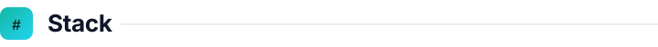
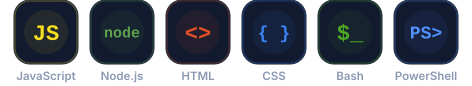
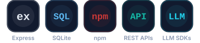
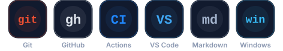
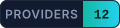
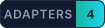
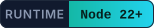
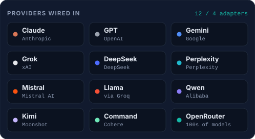
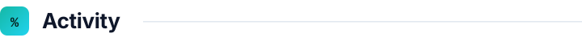

<!--
  Profile README for github.com/Abbad0708
  Every image under assets/ is generated by scripts/build-assets.mjs (node scripts/build-assets.mjs).
  Headings and the project title have light/dark variants switched with <picture>.
-->

  

&nbsp;&nbsp;
&nbsp;&nbsp;
&nbsp;&nbsp;

 

<picture>
  <source media="(prefers-color-scheme: dark)" srcset="assets/headings/about-d.svg" />
  
</picture>

I'm a Computer Science student who turns curiosity about new technology into software people can actually run. My current obsession is **tooling around large language models**: instead of arguing about which model is "best", I built the instrument that lets you put twelve of them next to each other and see for yourself.

I like small surface areas, few dependencies, data that stays on your own machine, and projects you can start with a single `npm start`.

<table>
  <tr>
    <td width="36" valign="top"></td>
    <td><strong>Now</strong> &nbsp;·&nbsp; building <a href="https://github.com/Abbad0708/Muster">Muster</a>, a self-hosted app that sends one prompt to up to 12 LLMs and lays the answers out side by side</td>
  </tr>
  <tr>
    <td valign="top"></td>
    <td><strong>Learning</strong> &nbsp;·&nbsp; local-first application design, provider SDKs and streaming APIs, and tests that catch real bugs rather than decorate a repo</td>
  </tr>
  <tr>
    <td valign="top"></td>
    <td><strong>Ask me about</strong> &nbsp;·&nbsp; comparing LLM providers fairly, Node.js without a build step, SQLite as an app database</td>
  </tr>
  <tr>
    <td valign="top"></td>
    <td><strong>Working principle</strong> &nbsp;·&nbsp; if it needs a sign-in, a cloud account and a bundler before it does anything useful, it is not finished yet</td>
  </tr>
</table>

 

<picture>
  <source media="(prefers-color-scheme: dark)" srcset="assets/headings/stack-d.svg" />
  
</picture>

<table>
  <tr>
    <td width="190" valign="middle"><strong>Languages &amp; runtime</strong></td>
    <td></td>
  </tr>
  <tr>
    <td valign="middle"><strong>Backend &amp; data</strong></td>
    <td></td>
  </tr>
  <tr>
    <td valign="middle"><strong>Workflow</strong></td>
    <td></td>
  </tr>
</table>

 

<picture>
  <source media="(prefers-color-scheme: dark)" srcset="assets/headings/work-d.svg" />
  
</picture>

<table>
  <tr>
    <td width="58%" valign="top">
      <a href="https://github.com/Abbad0708/Muster">
        <picture>
          <source media="(prefers-color-scheme: dark)" srcset="assets/headings/h-muster-d.svg" />
          
        </picture>
      </a>
      
<em>To muster: to gather and assemble.</em>

      
A local, single-user web app for comparing language models honestly. Every model answers in its own column, and on follow-up turns each model sees <strong>only its own history</strong>, never the other models' answers, so the comparison stays a fair test instead of a group chat.

      
Answers render as real Markdown (tables, code, headings), Perplexity citations become links, cards that hit a token limit say so, and a single failed model can be retried without re-running the rest. Every chat lives in one SQLite file on disk and is fully searchable.

      

        
        
        
        
        
      

      

        
        
        
        
        
        
      

      <table>
        <tr>
          <td width="30" valign="top"></td>
          <td><strong>Open source, actively developed.</strong> Clone it, run <code>npm install &amp;&amp; npm start</code>, open <code>localhost:3000</code>, add the API keys you have, and start comparing.</td>
        </tr>
      </table>
    </td>
    <td width="42%" valign="top" align="center">
      
        
      
      
    </td>
  </tr>
</table>

 

<picture>
  <source media="(prefers-color-scheme: dark)" srcset="assets/headings/activity-d.svg" />
  
</picture>

  

  

<picture>
  <source media="(prefers-color-scheme: dark)" srcset="https://raw.githubusercontent.com/Abbad0708/Abbad0708/output/github-snake-dark.svg" />
  
</picture>

 

<picture>
  <source media="(prefers-color-scheme: dark)" srcset="assets/headings/contact-d.svg" />
  
</picture>

I'm open to collaborating on developer tools, LLM experiments and open-source projects where a student who ships can be useful. LinkedIn is the fastest way to reach me; for anything about Muster, open an issue and I'll see it.

&nbsp;&nbsp;

  

