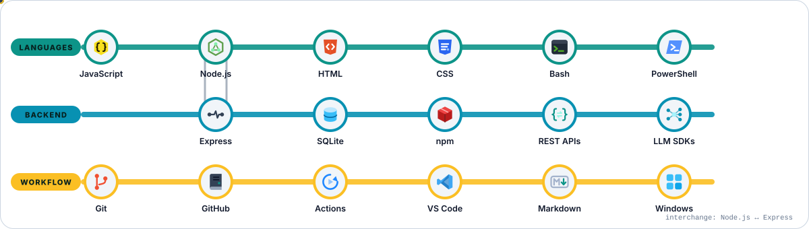
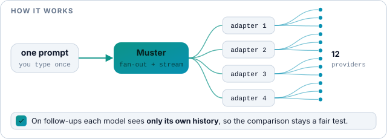
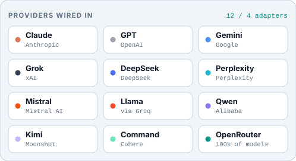
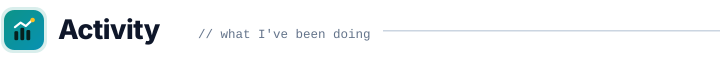

<!--
  Profile README for github.com/Abbad0708
  Every image under assets/{dark,light}/ is generated by scripts/build-assets.mjs.
  Each one is switched for the viewer's theme with <picture>.
-->

<picture><source media="(prefers-color-scheme: dark)" srcset="assets/dark/hero.svg" /></picture>

  

<a href="https://www.linkedin.com/in/muhammad-abbadurrehman/"><picture><source media="(prefers-color-scheme: dark)" srcset="assets/dark/badges/b-linkedin.svg" /></picture></a>&nbsp;&nbsp;
<a href="https://x.com/M_Abbad0708"><picture><source media="(prefers-color-scheme: dark)" srcset="assets/dark/badges/b-x.svg" /></picture></a>&nbsp;&nbsp;
<a href="https://github.com/Abbad0708/Muster"><picture><source media="(prefers-color-scheme: dark)" srcset="assets/dark/badges/b-muster.svg" /></picture></a>&nbsp;&nbsp;

 

<picture><source media="(prefers-color-scheme: dark)" srcset="assets/dark/headings/about.svg" /></picture>

<picture><source media="(prefers-color-scheme: dark)" srcset="assets/dark/emoji/wave.svg" /></picture>&nbsp; **Hi, I'm Abbad.** A Computer Science student who turns curiosity about new technology into software people can actually run. My current obsession is **tooling around large language models**: instead of arguing about which model is "best", I built the instrument that lets you put twelve of them next to each other and see for yourself.

I like small surface areas, few dependencies, data that stays on your own machine, and projects you can start with a single `npm start`.

<table>
  <tr>
    <td width="40" valign="top"><picture><source media="(prefers-color-scheme: dark)" srcset="assets/dark/emoji/rocket.svg" /></picture></td>
    <td><strong>Shipped</strong> &nbsp;·&nbsp; <a href="https://github.com/Abbad0708/Muster">Muster</a>, a self-hosted app that sends one prompt to up to 12 LLMs and lays the answers out side by side</td>
  </tr>
  <tr>
    <td valign="top"><picture><source media="(prefers-color-scheme: dark)" srcset="assets/dark/emoji/sprout.svg" /></picture></td>
    <td><strong>Learning</strong> &nbsp;·&nbsp; local-first application design, provider SDKs and streaming APIs, and tests that catch real bugs rather than decorate a repo</td>
  </tr>
  <tr>
    <td valign="top"><picture><source media="(prefers-color-scheme: dark)" srcset="assets/dark/emoji/chat.svg" /></picture></td>
    <td><strong>Ask me about</strong> &nbsp;·&nbsp; comparing LLM providers fairly, Node.js without a build step, SQLite as an app database</td>
  </tr>
  <tr>
    <td valign="top"><picture><source media="(prefers-color-scheme: dark)" srcset="assets/dark/emoji/compass.svg" /></picture></td>
    <td><strong>Working principle</strong> &nbsp;·&nbsp; if it needs a sign-in, a cloud account and a bundler before it does anything useful, it is not finished yet</td>
  </tr>
</table>

 

<picture><source media="(prefers-color-scheme: dark)" srcset="assets/dark/headings/stack.svg" /></picture>

<picture><source media="(prefers-color-scheme: dark)" srcset="assets/dark/stack-map.svg" /></picture>

 

<picture><source media="(prefers-color-scheme: dark)" srcset="assets/dark/headings/work.svg" /></picture>

<table>
  <tr>
    <td width="58%" valign="top">
      <a href="https://github.com/Abbad0708/Muster">
        <picture><source media="(prefers-color-scheme: dark)" srcset="assets/dark/headings/h-muster.svg" /></picture>
      </a>
      
<em>To muster: to gather and assemble.</em>

      
A local, single-user web app for comparing language models honestly. Every model answers in its own column, and on follow-up turns each model sees <strong>only its own history</strong>, never the other models' answers, so the comparison stays a fair test instead of a group chat.

      <picture><source media="(prefers-color-scheme: dark)" srcset="assets/dark/muster-flow.svg" /></picture>
      
Answers render as real Markdown (tables, code, headings), Perplexity citations become links, cards that hit a token limit say so, and a single failed model can be retried without re-running the rest. Every chat lives in one SQLite file on disk and is fully searchable.

      

        <picture><source media="(prefers-color-scheme: dark)" srcset="assets/dark/badges/m-providers.svg" /></picture>
        <picture><source media="(prefers-color-scheme: dark)" srcset="assets/dark/badges/m-adapters.svg" /></picture>
        <picture><source media="(prefers-color-scheme: dark)" srcset="assets/dark/badges/m-build.svg" /></picture>
        <picture><source media="(prefers-color-scheme: dark)" srcset="assets/dark/badges/m-data.svg" /></picture>
        <picture><source media="(prefers-color-scheme: dark)" srcset="assets/dark/badges/m-runtime.svg" /></picture>
      

      

        <picture><source media="(prefers-color-scheme: dark)" srcset="assets/dark/badges/t-node.svg" /></picture>
        <picture><source media="(prefers-color-scheme: dark)" srcset="assets/dark/badges/t-express.svg" /></picture>
        <picture><source media="(prefers-color-scheme: dark)" srcset="assets/dark/badges/t-sqlite.svg" /></picture>
        <picture><source media="(prefers-color-scheme: dark)" srcset="assets/dark/badges/t-vanilla.svg" /></picture>
        <picture><source media="(prefers-color-scheme: dark)" srcset="assets/dark/badges/t-markdown.svg" /></picture>
        <picture><source media="(prefers-color-scheme: dark)" srcset="assets/dark/badges/t-tests.svg" /></picture>
      

      <table>
        <tr>
          <td width="34" valign="top"><picture><source media="(prefers-color-scheme: dark)" srcset="assets/dark/emoji/terminal.svg" /></picture></td>
          <td><strong>Version 1 is out and open source.</strong> Clone it, run <code>npm install &amp;&amp; npm start</code>, open <code>localhost:3000</code>, add the API keys you have, and start comparing.</td>
        </tr>
      </table>
    </td>
    <td width="42%" valign="top" align="center">
      <picture><source media="(prefers-color-scheme: dark)" srcset="assets/dark/providers.svg" /></picture>
        
      <picture><source media="(prefers-color-scheme: dark)" srcset="https://img.shields.io/github/last-commit/Abbad0708/Muster?style=flat-square&color=14b8a6&labelColor=0b1220&label=last%20commit" /></picture>
      <picture><source media="(prefers-color-scheme: dark)" srcset="https://img.shields.io/github/stars/Abbad0708/Muster?style=flat-square&color=14b8a6&labelColor=0b1220" /></picture>
    </td>
  </tr>
</table>

 

<picture><source media="(prefers-color-scheme: dark)" srcset="assets/dark/headings/activity.svg" /></picture>

<a href="https://github.com/Abbad0708">
  <picture><source media="(prefers-color-scheme: dark)" srcset="https://github-readme-stats.vercel.app/api?username=Abbad0708&show_icons=true&hide_border=true&bg_color=0b1220&title_color=14b8a6&icon_color=14b8a6&text_color=e5eaf3&ring_color=14b8a6&hide_title=true" /></picture>
</a>
<a href="https://github.com/Abbad0708">
  <picture><source media="(prefers-color-scheme: dark)" srcset="https://github-readme-stats.vercel.app/api/top-langs/?username=Abbad0708&layout=compact&hide_border=true&bg_color=0b1220&title_color=14b8a6&text_color=e5eaf3&langs_count=6&hide_title=true" /></picture>
</a>

  

<a href="https://github.com/Abbad0708">
  <picture><source media="(prefers-color-scheme: dark)" srcset="https://github-readme-streak-stats.herokuapp.com?user=Abbad0708&hide_border=true&background=0b1220&ring=14b8a6&fire=14b8a6&currStreakLabel=14b8a6&sideLabels=e5eaf3&currStreakNum=f8fafc&sideNums=f8fafc&dates=8b98b1&stroke=1e293b" /></picture>
</a>

  

<picture>
  <source media="(prefers-color-scheme: dark)" srcset="https://raw.githubusercontent.com/Abbad0708/Abbad0708/output/github-snake-dark.svg" />
  
</picture>

 

<picture><source media="(prefers-color-scheme: dark)" srcset="assets/dark/headings/contact.svg" /></picture>

<picture><source media="(prefers-color-scheme: dark)" srcset="assets/dark/emoji/handshake.svg" /></picture>&nbsp; I'm open to collaborating on developer tools, LLM experiments and open-source projects where a student who ships can be useful. LinkedIn is the fastest way to reach me; for anything about Muster, open an issue and I'll see it.

<a href="https://www.linkedin.com/in/muhammad-abbadurrehman/"><picture><source media="(prefers-color-scheme: dark)" srcset="assets/dark/badges/b-message.svg" /></picture></a>&nbsp;&nbsp;
<a href="https://github.com/Abbad0708/Muster/issues/new"><picture><source media="(prefers-color-scheme: dark)" srcset="assets/dark/badges/b-muster.svg" /></picture></a>

  

<picture><source media="(prefers-color-scheme: dark)" srcset="assets/dark/footer.svg" /></picture>

