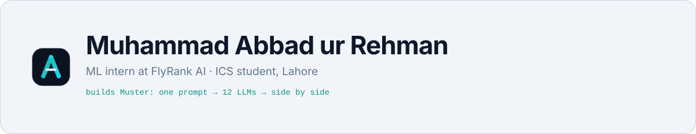
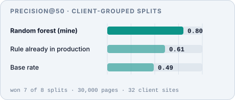

<!--
  Profile README for github.com/Abbad0708
  Every image under assets/{dark,light}/ is generated by scripts/build-assets.mjs.
  Each one is switched for the viewer's theme with <picture>.
-->

<picture><source media="(prefers-color-scheme: dark)" srcset="assets/dark/banner.svg" /></picture>

<p align="center">
<a href="https://www.linkedin.com/in/muhammad-abbadurrehman/"><picture><source media="(prefers-color-scheme: dark)" srcset="assets/dark/badges/b-linkedin.svg" /></picture></a>&nbsp;&nbsp;
<a href="mailto:m.abbad0708@gmail.com"><picture><source media="(prefers-color-scheme: dark)" srcset="assets/dark/badges/b-email.svg" /></picture></a>&nbsp;&nbsp;

</p>

<br/>

<picture><source media="(prefers-color-scheme: dark)" srcset="assets/dark/headings/about.svg" /></picture>

I work on the part of machine learning that decides whether a number can be trusted: the splits, the labels, and what the model is actually learning. I am an ICS student in Lahore, and this summer I was an ML engineering intern at FlyRank AI, where my ranker replaced a hand-written rule in production.

```text
→  Applied ML on real product data   ·  ranking, leakage-proof validation, Python, DuckDB
→  Self-hosted developer tools        ·  Muster puts 12 LLMs side by side, no build step, chats stay local
→  Learning next                      ·  C++, deeper Python, and the maths underneath the models
```

<br/>

<picture><source media="(prefers-color-scheme: dark)" srcset="assets/dark/headings/stack.svg" /></picture>

<table>
  <tr>
    <td width="50%" valign="top">
      <p><picture><source media="(prefers-color-scheme: dark)" srcset="assets/dark/stack/cat-data.svg" /></picture>&nbsp; <strong>Data &amp; Machine Learning</strong></p>
      <p><picture><source media="(prefers-color-scheme: dark)" srcset="assets/dark/stack/python.svg" /></picture>&nbsp;&nbsp;
      <picture><source media="(prefers-color-scheme: dark)" srcset="assets/dark/stack/sql.svg" /></picture>&nbsp;&nbsp;
      <picture><source media="(prefers-color-scheme: dark)" srcset="assets/dark/stack/duckdb.svg" /></picture>&nbsp;&nbsp;
      <picture><source media="(prefers-color-scheme: dark)" srcset="assets/dark/stack/ml.svg" /></picture>&nbsp;&nbsp;
      <picture><source media="(prefers-color-scheme: dark)" srcset="assets/dark/stack/cpp.svg" /></picture></p>
    </td>
    <td width="50%" valign="top">
      <p><picture><source media="(prefers-color-scheme: dark)" srcset="assets/dark/stack/cat-web.svg" /></picture>&nbsp; <strong>Web &amp; Shell</strong></p>
      <p><picture><source media="(prefers-color-scheme: dark)" srcset="assets/dark/stack/js.svg" /></picture>&nbsp;&nbsp;
      <picture><source media="(prefers-color-scheme: dark)" srcset="assets/dark/stack/node.svg" /></picture>&nbsp;&nbsp;
      <picture><source media="(prefers-color-scheme: dark)" srcset="assets/dark/stack/html.svg" /></picture>&nbsp;&nbsp;
      <picture><source media="(prefers-color-scheme: dark)" srcset="assets/dark/stack/css.svg" /></picture>&nbsp;&nbsp;
      <picture><source media="(prefers-color-scheme: dark)" srcset="assets/dark/stack/bash.svg" /></picture>&nbsp;&nbsp;
      <picture><source media="(prefers-color-scheme: dark)" srcset="assets/dark/stack/powershell.svg" /></picture></p>
    </td>
  </tr>
  <tr>
    <td width="50%" valign="top">
      <p><picture><source media="(prefers-color-scheme: dark)" srcset="assets/dark/stack/cat-backend.svg" /></picture>&nbsp; <strong>Backend &amp; Data</strong></p>
      <p><picture><source media="(prefers-color-scheme: dark)" srcset="assets/dark/stack/express.svg" /></picture>&nbsp;&nbsp;
      <picture><source media="(prefers-color-scheme: dark)" srcset="assets/dark/stack/sqlite.svg" /></picture>&nbsp;&nbsp;
      <picture><source media="(prefers-color-scheme: dark)" srcset="assets/dark/stack/npm.svg" /></picture>&nbsp;&nbsp;
      <picture><source media="(prefers-color-scheme: dark)" srcset="assets/dark/stack/api.svg" /></picture>&nbsp;&nbsp;
      <picture><source media="(prefers-color-scheme: dark)" srcset="assets/dark/stack/llm.svg" /></picture></p>
    </td>
    <td width="50%" valign="top">
      <p><picture><source media="(prefers-color-scheme: dark)" srcset="assets/dark/stack/cat-workflow.svg" /></picture>&nbsp; <strong>Tools &amp; Workflow</strong></p>
      <p><picture><source media="(prefers-color-scheme: dark)" srcset="assets/dark/stack/git.svg" /></picture>&nbsp;&nbsp;
      <picture><source media="(prefers-color-scheme: dark)" srcset="assets/dark/stack/github.svg" /></picture>&nbsp;&nbsp;
      <picture><source media="(prefers-color-scheme: dark)" srcset="assets/dark/stack/actions.svg" /></picture>&nbsp;&nbsp;
      <picture><source media="(prefers-color-scheme: dark)" srcset="assets/dark/stack/vscode.svg" /></picture>&nbsp;&nbsp;
      <picture><source media="(prefers-color-scheme: dark)" srcset="assets/dark/stack/markdown.svg" /></picture>&nbsp;&nbsp;
      <picture><source media="(prefers-color-scheme: dark)" srcset="assets/dark/stack/windows.svg" /></picture></p>
    </td>
  </tr>
</table>

<br/>

<picture><source media="(prefers-color-scheme: dark)" srcset="assets/dark/headings/experience.svg" /></picture>

<table>
  <tr>
    <td width="200" valign="top">
      <strong>FlyRank AI</strong><br/>
      ML Engineering Intern<br/>
      <sub>Jul – Aug 2026</sub>
    </td>
    <td valign="top">
      <p>About 10,000 pages in FlyRank's dataset were losing impressions while still pulling real traffic, and an editor clears maybe 50 a week. The list never empties, so the only thing anyone controls is what sits at the top of it. I built the thing that decides the order.</p>
      <ul>
        <li>Ranked review queue over <strong>30,000 pages from 32 client sites</strong>, on anonymised Search Console and Analytics data.</li>
        <li>First version scored 0.96 and I threw it out: random row splits let the same client sit on both sides, so the model was learning <em>who the client was</em>, not whether the page was dying. Split by client and it fell to 0.80. That 0.16 was never mine to keep.</li>
        <li>Fed the harness a feature built from the label window on purpose. It returned a perfect 1.000, which is what a leak should look like when validation is working.</li>
        <li>Rebuilt the label forward-looking on the full 79-million-row release in DuckDB to confirm the framing held on data I had never trained on.</li>
        <li>Final, on identical client-grouped splits: <strong>0.80 precision@50</strong> for the random forest, 0.61 for the hand-written rule in production, 0.49 base rate. Won 7 splits of 8. Roughly 12 more genuinely declining pages per editor-week.</li>
        <li>Shipped with reason codes on every row so editors can argue back, plus retrain and review triggers with exact thresholds, so it is clear when to stop trusting it.</li>
        <li>Known limits, stated up front: weakest on the highest-traffic pages, and nothing proves a refresh brings traffic back. It orders a reading list, and does that well.</li>
      </ul>
      <picture><source media="(prefers-color-scheme: dark)" srcset="assets/dark/ranker-chart.svg" /></picture>
      <p>
        <picture><source media="(prefers-color-scheme: dark)" srcset="assets/dark/badges/t-python.svg" /></picture>
        <picture><source media="(prefers-color-scheme: dark)" srcset="assets/dark/badges/t-duckdb.svg" /></picture>
        <picture><source media="(prefers-color-scheme: dark)" srcset="assets/dark/badges/t-rf.svg" /></picture>
      </p>
      <p><sub>Built in a professional setting; the code and data belong to FlyRank AI.</sub></p>
    </td>
  </tr>
  <tr>
    <td valign="top">
      <strong>Allah Wale Foundation</strong><br/>
      AWT Youth Fellow<br/>
      <sub>Jul – Aug 2025 · Lahore</sub>
    </td>
    <td valign="top">
      <p>Selected for the AWT Youth Fellowship, a leadership and personal-development programme built around experiential learning, mentorship and social-impact projects. Designed a Social Action Project on improving access to education; sessions on public speaking, leadership and communication; an exposure visit to the Civil Services Academy.</p>
    </td>
  </tr>
</table>

<br/>

<picture><source media="(prefers-color-scheme: dark)" srcset="assets/dark/headings/work.svg" /></picture>

<a href="https://github.com/Abbad0708/Muster"><picture><source media="(prefers-color-scheme: dark)" srcset="assets/dark/headings/h-muster.svg" /></picture></a>

*To muster: to gather and assemble.* A local, single-user web app for comparing language models honestly. Every model answers in its own column, and on follow-up turns each model sees **only its own history**, never the other models' answers, so the comparison stays a fair test instead of a group chat.

- Twelve providers through four adapters: Claude, GPT, Gemini, Grok, DeepSeek, Perplexity, Mistral, Llama (Groq), Qwen, Kimi, Command and OpenRouter
- Answers render as real Markdown, Perplexity citations become links, truncated cards say so, and a single failed model can be retried alone
- Every chat lives in one SQLite file on disk and is fully searchable; no sign-in, no telemetry, no build step
- Plain HTML and JavaScript on Node 22 and Express, with a custom DOM-based Markdown renderer and tests that use mock providers and a headless browser

<p>
  <picture><source media="(prefers-color-scheme: dark)" srcset="assets/dark/badges/m-providers.svg" /></picture>
  <picture><source media="(prefers-color-scheme: dark)" srcset="assets/dark/badges/m-build.svg" /></picture>
  <picture><source media="(prefers-color-scheme: dark)" srcset="assets/dark/badges/m-data.svg" /></picture>
  &nbsp;
  <picture><source media="(prefers-color-scheme: dark)" srcset="assets/dark/badges/t-node.svg" /></picture>
  <picture><source media="(prefers-color-scheme: dark)" srcset="assets/dark/badges/t-sqlite.svg" /></picture>
  <picture><source media="(prefers-color-scheme: dark)" srcset="assets/dark/badges/t-vanilla.svg" /></picture>
</p>

<picture><source media="(prefers-color-scheme: dark)" srcset="assets/dark/emoji/terminal.svg" /></picture>&nbsp; **Version 1 is out and open source.** `npm install && npm start`, open `localhost:3000`, add the API keys you have, start comparing.

<br/>

<picture><source media="(prefers-color-scheme: dark)" srcset="assets/dark/headings/contact.svg" /></picture>

<picture><source media="(prefers-color-scheme: dark)" srcset="assets/dark/emoji/handshake.svg" /></picture>&nbsp; Open to ML and data internships, developer-tool collaborations and open-source projects where a student who ships can be useful. LinkedIn is the fastest way to reach me; for anything about Muster, open an issue.

<picture><source media="(prefers-color-scheme: dark)" srcset="assets/dark/emoji/pin.svg" /></picture>&nbsp; Lahore, Pakistan · UTC+5

<p align="center">
<a href="https://www.linkedin.com/in/muhammad-abbadurrehman/"><picture><source media="(prefers-color-scheme: dark)" srcset="assets/dark/badges/b-message.svg" /></picture></a>&nbsp;&nbsp;
<a href="mailto:m.abbad0708@gmail.com"><picture><source media="(prefers-color-scheme: dark)" srcset="assets/dark/badges/b-email.svg" /></picture></a>
</p>

<picture><source media="(prefers-color-scheme: dark)" srcset="assets/dark/footer.svg" /></picture>
