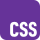
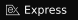
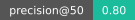

<!--
  Profile README for github.com/Abbad0708
  Every image under assets/{dark,light}/ is generated by scripts/build-assets.mjs.
  Each one is switched for the viewer's theme with <picture>.
-->


<p align="center">
<a href="https://www.linkedin.com/in/muhammad-abbadurrehman/"></a>
<a href="mailto:m.abbad0708@gmail.com"></a>

</p>

<br/>

<picture><source media="(prefers-color-scheme: dark)" srcset="assets/dark/headings/about.svg" /></picture>

I work on the part of machine learning that decides whether a number can be trusted: the splits, the labels, and what the model is actually learning. I am an ICS student in Lahore, and this summer I was an ML engineering intern at FlyRank AI, where my ranker replaced a hand-written rule in production.

```text
→  Applied ML on real product data   ·  ranking, leakage-proof validation, Python, DuckDB
→  Self-hosted developer tools        ·  Muster puts 12 LLMs side by side, no build step, chats stay local
→  Learning next                      ·  C++, deeper Python, and the maths underneath the models
```

<br/>

<picture><source media="(prefers-color-scheme: dark)" srcset="assets/dark/headings/stack.svg" /></picture>

<table>
  <tr>
    <td width="50%" valign="top">
      <p><picture><source media="(prefers-color-scheme: dark)" srcset="assets/dark/stack/cat-code.svg" /></picture>&nbsp; <strong>Languages</strong></p>
      <p><picture><source media="(prefers-color-scheme: dark)" srcset="assets/dark/stack/python.svg" /></picture>&nbsp;&nbsp;
      <picture><source media="(prefers-color-scheme: dark)" srcset="assets/dark/stack/cpp.svg" /></picture>&nbsp;&nbsp;
      <picture><source media="(prefers-color-scheme: dark)" srcset="assets/dark/stack/js.svg" /></picture>&nbsp;&nbsp;
      <picture><source media="(prefers-color-scheme: dark)" srcset="assets/dark/stack/sql.svg" /></picture>&nbsp;&nbsp;
      <picture><source media="(prefers-color-scheme: dark)" srcset="assets/dark/stack/html.svg" /></picture>&nbsp;&nbsp;
      <picture><source media="(prefers-color-scheme: dark)" srcset="assets/dark/stack/css.svg" /></picture>&nbsp;&nbsp;
      <picture><source media="(prefers-color-scheme: dark)" srcset="assets/dark/stack/bash.svg" /></picture>&nbsp;&nbsp;
      <picture><source media="(prefers-color-scheme: dark)" srcset="assets/dark/stack/powershell.svg" /></picture></p>
    </td>
    <td width="50%" valign="top">
      <p><picture><source media="(prefers-color-scheme: dark)" srcset="assets/dark/stack/cat-ds.svg" /></picture>&nbsp; <strong>Data Science &amp; Machine Learning</strong></p>
      <p><picture><source media="(prefers-color-scheme: dark)" srcset="assets/dark/stack/python.svg" /></picture>&nbsp;&nbsp;
      <picture><source media="(prefers-color-scheme: dark)" srcset="assets/dark/stack/anaconda.svg" /></picture>&nbsp;&nbsp;
      <picture><source media="(prefers-color-scheme: dark)" srcset="assets/dark/stack/colab.svg" /></picture>&nbsp;&nbsp;
      <picture><source media="(prefers-color-scheme: dark)" srcset="assets/dark/stack/ml.svg" /></picture>&nbsp;&nbsp;
      <picture><source media="(prefers-color-scheme: dark)" srcset="assets/dark/stack/duckdb.svg" /></picture>&nbsp;&nbsp;
      <picture><source media="(prefers-color-scheme: dark)" srcset="assets/dark/stack/sql.svg" /></picture></p>
    </td>
  </tr>
  <tr>
    <td width="50%" valign="top">
      <p><picture><source media="(prefers-color-scheme: dark)" srcset="assets/dark/stack/cat-db.svg" /></picture>&nbsp; <strong>Data Engineering &amp; Databases</strong></p>
      <p><picture><source media="(prefers-color-scheme: dark)" srcset="assets/dark/stack/duckdb.svg" /></picture>&nbsp;&nbsp;
      <picture><source media="(prefers-color-scheme: dark)" srcset="assets/dark/stack/sqlite.svg" /></picture>&nbsp;&nbsp;
      <picture><source media="(prefers-color-scheme: dark)" srcset="assets/dark/stack/sql.svg" /></picture>&nbsp;&nbsp;
      <picture><source media="(prefers-color-scheme: dark)" srcset="assets/dark/stack/api.svg" /></picture></p>
    </td>
    <td width="50%" valign="top">
      <p><picture><source media="(prefers-color-scheme: dark)" srcset="assets/dark/stack/cat-globe.svg" /></picture>&nbsp; <strong>Web &amp; Automation</strong></p>
      <p><picture><source media="(prefers-color-scheme: dark)" srcset="assets/dark/stack/js.svg" /></picture>&nbsp;&nbsp;
      <picture><source media="(prefers-color-scheme: dark)" srcset="assets/dark/stack/node.svg" /></picture>&nbsp;&nbsp;
      <picture><source media="(prefers-color-scheme: dark)" srcset="assets/dark/stack/express.svg" /></picture>&nbsp;&nbsp;
      <picture><source media="(prefers-color-scheme: dark)" srcset="assets/dark/stack/html.svg" /></picture>&nbsp;&nbsp;
      <picture><source media="(prefers-color-scheme: dark)" srcset="assets/dark/stack/css.svg" /></picture>&nbsp;&nbsp;
      <picture><source media="(prefers-color-scheme: dark)" srcset="assets/dark/stack/npm.svg" /></picture>&nbsp;&nbsp;
      <picture><source media="(prefers-color-scheme: dark)" srcset="assets/dark/stack/bash.svg" /></picture>&nbsp;&nbsp;
      <picture><source media="(prefers-color-scheme: dark)" srcset="assets/dark/stack/powershell.svg" /></picture></p>
    </td>
  </tr>
  <tr>
    <td width="50%" valign="top">
      <p><picture><source media="(prefers-color-scheme: dark)" srcset="assets/dark/stack/cat-spark.svg" /></picture>&nbsp; <strong>AI &amp; LLM Tooling</strong></p>
      <p><picture><source media="(prefers-color-scheme: dark)" srcset="assets/dark/stack/claude.svg" /></picture>&nbsp;&nbsp;
      <picture><source media="(prefers-color-scheme: dark)" srcset="assets/dark/stack/openai.svg" /></picture>&nbsp;&nbsp;
      <picture><source media="(prefers-color-scheme: dark)" srcset="assets/dark/stack/gemini.svg" /></picture>&nbsp;&nbsp;
      <picture><source media="(prefers-color-scheme: dark)" srcset="assets/dark/stack/copilot.svg" /></picture>&nbsp;&nbsp;
      <picture><source media="(prefers-color-scheme: dark)" srcset="assets/dark/stack/llm.svg" /></picture>&nbsp;&nbsp;
      <picture><source media="(prefers-color-scheme: dark)" srcset="assets/dark/stack/prompt.svg" /></picture></p>
    </td>
    <td width="50%" valign="top">
      <p><picture><source media="(prefers-color-scheme: dark)" srcset="assets/dark/stack/cat-chart.svg" /></picture>&nbsp; <strong>Analytics &amp; BI</strong></p>
      <p><picture><source media="(prefers-color-scheme: dark)" srcset="assets/dark/stack/excel.svg" /></picture>&nbsp;&nbsp;
      <picture><source media="(prefers-color-scheme: dark)" srcset="assets/dark/stack/tableau.svg" /></picture>&nbsp;&nbsp;
      <picture><source media="(prefers-color-scheme: dark)" srcset="assets/dark/stack/powerbi.svg" /></picture></p>
    </td>
  </tr>
  <tr>
    <td width="50%" colspan="2" valign="top">
      <p><picture><source media="(prefers-color-scheme: dark)" srcset="assets/dark/stack/cat-gear.svg" /></picture>&nbsp; <strong>Tools</strong></p>
      <p><picture><source media="(prefers-color-scheme: dark)" srcset="assets/dark/stack/git.svg" /></picture>&nbsp;&nbsp;
      <picture><source media="(prefers-color-scheme: dark)" srcset="assets/dark/stack/github.svg" /></picture>&nbsp;&nbsp;
      <picture><source media="(prefers-color-scheme: dark)" srcset="assets/dark/stack/actions.svg" /></picture>&nbsp;&nbsp;
      <picture><source media="(prefers-color-scheme: dark)" srcset="assets/dark/stack/vscode.svg" /></picture>&nbsp;&nbsp;
      <picture><source media="(prefers-color-scheme: dark)" srcset="assets/dark/stack/markdown.svg" /></picture>&nbsp;&nbsp;
      <picture><source media="(prefers-color-scheme: dark)" srcset="assets/dark/stack/windows.svg" /></picture></p>
    </td>
  </tr>
</table>

<br/>

<picture><source media="(prefers-color-scheme: dark)" srcset="assets/dark/headings/work.svg" /></picture>

<picture><source media="(prefers-color-scheme: dark)" srcset="assets/dark/headings/h-muster.svg" /></picture>

*A self-hosted web app that sends one prompt to up to twelve LLMs and lays the answers out side by side, so model choice is measured instead of argued.*

Wired **12 providers** (Claude, GPT, Gemini, Grok, DeepSeek, Perplexity, Mistral, Llama via Groq, Qwen, Kimi, Command and OpenRouter) through **4 adapters** on a **Node.js 22** and **Express** backend, with every chat kept in a local **SQLite** file and **full-text search** across all prompts and answers. On follow-up turns each model sees **only its own history**, never the others' replies, so the comparison stays a **fair test**. Answers render as real **Markdown** through a custom **DOM-based renderer** (no `innerHTML`), **Perplexity citations** become links, cards that hit a token limit are flagged, and a single failed model can be **retried alone**. Plain HTML and JavaScript frontend with **no build step**; tests run against **mock providers** and a **headless browser**.





> <picture><source media="(prefers-color-scheme: dark)" srcset="assets/dark/emoji/terminal.svg" /></picture> Open source, version 1 released: [github.com/Abbad0708/Muster](https://github.com/Abbad0708/Muster)

<br/>

<picture><source media="(prefers-color-scheme: dark)" srcset="assets/dark/headings/h-ranker.svg" /></picture>

*A ranked review queue that tells editors which of 30,000 decaying pages to open first, replacing the hand-written rule that was running in production.*

Ranked **30,000 pages from 32 client sites** on anonymised **Search Console** and **Analytics** data. The first model scored **0.96** and was thrown out: random row splits let the same client sit on both sides, so it was learning **who the client was**, not whether the page was dying. Split **by client** and it fell to **0.80**, the honest number. A feature built deliberately from the label window scored a perfect **1.000**, proof the harness catches leaks. Rebuilt the label **forward-looking** on the full **79-million-row** release in **DuckDB** to confirm the framing held on data never trained on. Final, on identical client-grouped splits: **0.80 precision@50** for the **random forest** against **0.61** for the production rule and a **0.49** base rate, winning **7 splits of 8**, roughly **12 more genuinely declining pages per editor-week**. Every row ships with a **reason code** so editors can argue back, plus **retrain and review triggers** with exact thresholds.




> <picture><source media="(prefers-color-scheme: dark)" srcset="assets/dark/emoji/briefcase.svg" /></picture> Built in a professional setting (ML engineering internship, Jul–Aug 2026)

<br/>

<picture><source media="(prefers-color-scheme: dark)" srcset="assets/dark/headings/contact.svg" /></picture>

<picture><source media="(prefers-color-scheme: dark)" srcset="assets/dark/emoji/handshake.svg" /></picture>&nbsp; Open to ML and data internships, developer-tool collaborations and open-source projects where a student who ships can be useful. LinkedIn is the fastest way to reach me; for anything about Muster, open an issue.

<picture><source media="(prefers-color-scheme: dark)" srcset="assets/dark/emoji/pin.svg" /></picture>&nbsp; Lahore, Pakistan · UTC+5

<p align="center">
<a href="https://www.linkedin.com/in/muhammad-abbadurrehman/"></a>
<a href="mailto:m.abbad0708@gmail.com"></a>
</p>
